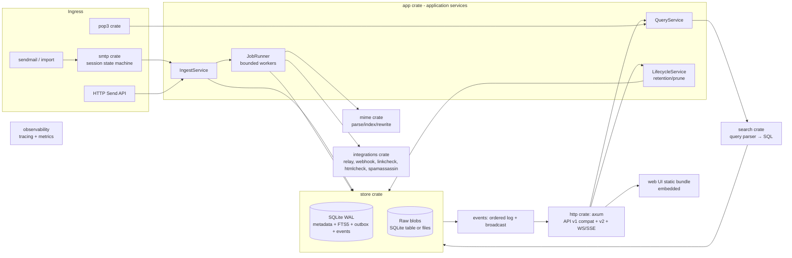
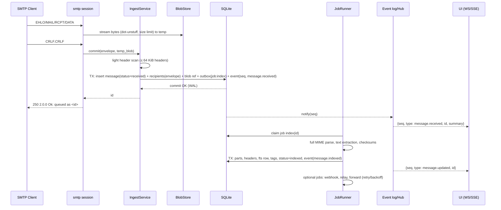

# معماری، مدل داده، crateها و ساختار مخزن

## 10. Architecture Alternatives and Final Recommendation

### گزینه‌ها

| معیار | A: برنامه یکپارچه (ماژول‌های داخلی بدون مرز سخت) | B: Modular monolith (crateهای workspace با trait مرزی) | C: Monolith + workerهای مستقل (پروسس جدا برای parse/check) |
|---|---|---|---|
| RAM idle | کمترین | تقریباً برابر A (مرز crate هزینه runtime ندارد) | بیشتر (چند پروسس، هر کدام runtime خود) |
| CPU idle | ~0 | ~0 | ~0 + heartbeat/IPC |
| Startup | کمترین | برابر A | بیشتر (spawn) |
| Latency ingest | کم | کم | IPC در مسیر یا ingest سبک + صف |
| Throughput | خوب | خوب | بالاتر فقط وقتی parse گلوگاه CPU باشد — برای ابزار توسعه محلی محتمل نیست |
| سادگی توسعه | بالا در ابتدا، کاهش با رشد | بالا | پایین |
| نگهداری | وابستگی‌های درهم بین ماژول‌ها | مرزهای قابل‌تست | پیچیده (نسخه‌بندی IPC) |
| Deployment | یک باینری | یک باینری | یک باینری با چند زیرفرمان یا چند باینری |
| تست‌پذیری | متوسط | بالا (fake برای هر trait) | بالا ولی کند |
| امنیت | — | — | بهتر: ایزوله کردن parser/thumbnail (crash/RCE محدود) |
| توسعه آینده | سخت | خوب | خوب |

### توصیه: **B — Modular monolith** (ADR-001)
- یک باینری، یک runtime tokio. کارهای CPU-bound (parse MIME، thumbnail، zstd، HTML rewrite) روی `spawn_blocking` با **سقف هم‌زمانی** (Semaphore، پیش‌فرض = تعداد هسته).
- ریسک امنیتی parser در Rust (memory-safe) پایین‌تر از دلیل جداسازی پروسس است؛ در عوض: سقف عمق/تعداد part، timeout، `catch_unwind` در مرز job، fuzzing.
- گزینه C به‌عنوان مسیر آینده برای ایزوله‌سازی افزونه‌های پرریسک (مثلاً SpamAssassin/render) نگه داشته می‌شود — بدون microservice.

### نمودار معماری



### جریان دریافت پیام



**مراحل (مسیر اصلی):**
1. **Accept**: Semaphore اتصال؛ banner فوری (بدون rDNS).
2. **Session**: state machine خالص (بدون I/O) — ورودی خط/بایت، خروجی پاسخ؛ قابل تست جدا از socket.
3. **DATA**: بایت‌ها به‌صورت stream (buffer ثابت 64 KiB) dot-unstuff و به blob موقت نوشته می‌شوند؛ hash SHA-256 هم‌زمان محاسبه می‌شود؛ سقف اندازه در حین stream.
4. **Commit پایدار**: یک تراکنش SQLite شامل پیام، envelope، ارجاع blob، outbox job، event. پاسخ `250` **فقط پس از commit**. خطای DB → `451 4.3.0` (کلاینت retry می‌کند).
5. **Header scan سبک** پیش از commit (برای ظاهر شدن فوری در لیست: From، To، Subject، Date، Message-ID، Size).
6. **Index** پس‌زمینه: parse کامل، FTS، tags، checksumها.
7. **Event**: هر تغییر state یک ردیف در `events` با `seq` یکنواخت؛ Hub پس از commit از notify ارسال می‌کند.

**هدف latency:** مراحل 3–5 روی پیام کوچک — هدف پیشنهادی، [05-performance.md](05-performance.md).

### مرزهای معماری

| مرز | مالک داده | مدل خطا | مسئول retry | تست |
|---|---|---|---|---|
| smtp ↔ app | smtp مالک session و temp blob تا commit | `IngestError::{Transient, Rejected(code,msg), TooLarge}` → نگاشت به کد SMTP | کلاینت SMTP (4xx) | state machine unit + transcript |
| app ↔ store | store مالک schema و تراکنش | `StoreError::{Busy, Full(ENOSPC), Corrupt, NotFound}` | app برای Busy (۳ بار با backoff کوتاه)؛ Full → 452/451 | store با SQLite موقت؛ fault injection |
| app ↔ jobs | outbox در DB | job: `Retryable` / `Permanent` | JobRunner (backoff نمایی، سقف تلاش) | تست crash بین claim و complete |
| jobs ↔ integrations | integration بدون state پایدار | خطای HTTP/SMTP طبقه‌بندی‌شده | JobRunner | mock server |
| store ↔ events/http | جدول events | — | کلاینت (resume با seq) | تست gap و resume |
| http ↔ UI | قرارداد OpenAPI | Problem JSON (v2) | UI | contract + e2e |

## 9. Data Model Proposal

منبع حقیقت هر داده در ستون «SoT».

| Entity | جدول | فیلدهای کلیدی | SoT | ایندکس / قید |
|---|---|---|---|---|
| Message | `messages` | `id` (ULID متنی 26 کاراکتر — مرتب بر اساس زمان؛ v1 همان را برمی‌گرداند)، `seq` (INTEGER PK alias rowid)، `received_at` (ms UTC)، `namespace_id`، `status` (received/indexed/parse_failed)، `size`، `raw_sha256`، `blob_ref`، `read`، `header_date`، `subject`، `from_name`، `from_addr`، `message_id_hdr`، `snippet`، `attachment_count`، `inline_count`، `source` (smtp/send_api/import) | دریافت: سرور؛ هدرها: پیام خام | `(namespace_id, received_at DESC, seq DESC)` برای لیست و keyset؛ `(message_id_hdr)`؛ `(read)` جزئی `WHERE read=0` |
| Envelope | `envelopes` | `message_id` PK/FK، `mail_from`، `mail_params`، `helo`، `remote_ip`، `tls_proto`، `auth_user` | **پروتکل SMTP** (هرگز از هدر استخراج نمی‌شود) | — |
| Recipient | `recipients` | `message_id`، `kind` (envelope/to/cc/bcc/reply_to)، `name`، `addr`، `addr_lower`، `ordinal` | envelope: SMTP؛ بقیه: هدر | `(addr_lower, kind)`؛ `(message_id)` |
| Header | — (در پیام خام) | — | پیام خام | فقط هدرهای منتخب ستون می‌شوند؛ API headers از raw parse lazy |
| MIME Part | `parts` | `message_id`، `part_id` (مسیر `1.2.1`)، `parent`، `content_type`، `charset`، `disposition`، `filename`، `content_id`، `transfer_encoding`، `offset`، `length`، `decoded_size`، `sha256`، `md5`، `sha1` | پیام خام | `(message_id, part_id)` PK؛ `(message_id, content_id)` |
| Attachment | view روی `parts` | `disposition=attachment` یا نام‌دار | — | — |
| Tag | `tags` | `id`، `name` (NFC)، `name_fold` (casefold) | کاربر/قوانین | UNIQUE(`name_fold`) |
| MessageTag | `message_tags` | `message_id`، `tag_id`، `source` (manual/x-tags/plus/rule/username) | — | PK(`message_id`,`tag_id`)؛ `(tag_id)`؛ `WITHOUT ROWID` |
| MessageMetadata / Search | `message_fts` (FTS5، tokenizer `trigram`) | `subject`، `addresses`، `body_text`، `filenames` | مشتق | contentless/external-content با rowid=`seq` |
| Blob | `blobs` (اگر SQLite) | `ref`، `compressed`، `data` | پیام خام | — |
| WebhookDelivery / RelayAttempt / Job | `outbox` | `id`، `kind`، `message_id`، `payload`، `attempts`، `next_at`، `last_error`، `state`، `idempotency_key` | سرور | `(state, next_at)` |
| Event | `events` | `seq` (AUTOINCREMENT)، `at`، `type`، `message_id`، `data` (JSON کوچک) | سرور | نگهداری: N آخر (پیش‌فرض 10 000) یا 24h |
| Configuration قابل‌ذخیره | `settings` | `key`، `value` | — | فقط state runtime (Chaos، UI prefs)، نه پیکربندی اصلی |
| Namespace (P2) | `namespaces` | `id`، `name` | — | پیام پیش‌فرض: namespace 0 |
| Schema | `schema_migrations` | `version`، `applied_at`، `checksum` | — | هر migration در یک تراکنش |

**تصمیم‌های مهم:**
- **Envelope در برابر هدر**: هر دو حفظ می‌شوند؛ Bcc شبیه‌سازی‌شده v1 = (`bcc` هدر) ∪ (`envelope` − to − cc − bcc).
- **حذف**: در یک تراکنش از همه جداول (FK با `ON DELETE CASCADE`)؛ blob فایل‌محور: ابتدا حذف ردیف، سپس unlink؛ اسکن orphan در startup و روزانه.
- **Crash recovery**: پیام فقط پس از commit وجود دارد؛ temp blobهای بدون ردیف در startup حذف؛ jobهای `claimed` بدون lease معتبر به `pending` بازمی‌گردند.
- **Retention**: `max_messages` در همان تراکنش batch ingest (حذف قدیمی‌ترین‌ها)؛ `max_age` و `max_disk` با job دوره‌ای (هر 60s).
- **Disk full**: ENOSPC → پاسخ `452 4.3.1 Insufficient system storage` و event `storage.full`؛ prune اضطراری اختیاری.
- **Hash**: SHA-256 پیام خام برای dedupe اختیاری و تشخیص corruption (`verify` فرمان).

### ADR-003: محل ذخیره پیام خام (تصمیم وابسته به benchmark)

| | SQLite blob (پیش‌فرض پیشنهادی) | فایل جدا (`blobs/ab/cd/<sha256>.eml.zst`) |
|---|---|---|
| اتمی بودن | یک تراکنش | دو مرحله (fsync فایل → commit ردیف)؛ نیاز به orphan sweep |
| Backup | یک فایل (`VACUUM INTO` / backup API) | فایل + دایرکتوری |
| پیام بزرگ | incremental blob I/O؛ رشد WAL | streaming طبیعی؛ sendfile |
| حذف انبوه | نیاز به VACUUM/incremental vacuum | unlink؛ فضا فوری آزاد |
| Windows | ساده | file locking، antivirus، تعداد فایل |
| NFS | WAL روی NFS مشکل‌دار | — |

**فرضیه:** برای پیام‌های < 1 MiB، SQLite blob ساده‌تر و کافی است. **معیار تغییر تصمیم** (benchmark `B-STOR`): اگر با 50 000 پیام شامل ۵٪ پیام 10–50 MiB، (الف) p95 ingest در SQLite > 2× حالت فایل، یا (ب) زمان حذف 10 000 پیام + بازیابی فضا > 10s، آنگاه حالت هیبرید (blob > آستانه روی فایل) انتخاب شود. trait `BlobStore` از روز اول هر دو را ممکن می‌کند.

## 11. Rust Crate Evaluation Matrix

داده‌ها از crates.io API در 2026-10-24. Rust stable جاری: **1.99.1** (toolchain محیط توسعه مالک نیز 1.99.1، MSVC، Visual Studio 2026). سیاست (ADR-015): toolchain پین 1.99.1، MSRV اعلام‌شده **1.98** ← همه crateهای جدول (بالاترین MSRV: mail-parser 1.0 با 1.98) سازگارند و علامت‌های «MSRV» صرفاً اطلاعاتی‌اند. روی Windows، `cmake` نصب نیست ← provider `ring` برای rustls (نه `aws-lc-rs`). «Not verified» = API پاسخ نداد.

| نیاز | انتخاب پیشنهادی (نسخه، تاریخ، مجوز، MSRV) | جایگزین | دلیل انتخاب | هزینه و ریسک | منبع |
|---|---|---|---|---|---|
| Async runtime | tokio 1.54.1 (2026-10-21، MIT، 1.85) | — | استاندارد اکوسیستم؛ زمان مجازی برای تست timeout | — | crates.io/crates/tokio |
| HTTP server | axum 0.8.9 (2026-04-14، MIT، 1.80) + hyper 1.12.0 | — | ws داخلی، tower middleware | 0.x: breaking در 0.9 | crates.io/crates/axum |
| Middleware | tower-http 0.7.1 (2026-08-31، MIT، 1.65)، tower 0.5.3 | — | compression، CORS، limit، trace | — | crates.io |
| TLS | rustls 0.23.46 (2026-10-14، Apache-2.0/ISC/MIT، 1.71)، tokio-rustls 0.26.6، rustls-pki-types 1.15.1 (PEM) | native-tls | Rust خالص (به‌جز provider)، cross-platform یکسان | provider: `aws-lc-rs` نیاز به C toolchain/cmake در cross-compile؛ **پیشنهاد `ring` provider** — نسخه ring Not verified | crates.io/crates/rustls |
| گواهی self-signed (dev) | rcgen 0.14.10 (MIT/Apache، **MSRV 1.88**) | — | `--tls-auto` برای dev | — | crates.io/crates/rcgen |
| SMTP server | **پیاده‌سازی داخلی** state machine؛ ارزیابی `smtp-proto` 0.2.5 (2026-10-01، Apache/MIT، Stalwart) برای parse فرمان | `samotop`، `mailin-embedded` (وضعیت نگهداری Not verified) | کنترل کامل بر کدهای پاسخ، Chaos، transcript | smtp-proto: دانلود کم (~147k اخیر)، MSRV اعلام‌نشده | crates.io/crates/smtp-proto |
| SMTP client (relay) | lettre 0.11.23 (2026-08-03، MIT، 1.85) | mail-send 0.6.2 (Apache/MIT) | پرکاربردتر (8.1M دانلود اخیر)، rustls، auth | — | crates.io/crates/lettre |
| MIME parser | mail-parser (Stalwart، Apache/MIT) | `mailparse` (Not verified) | RFC 2047/2231، charsetهای متعدد، zero-copy با offset | **نسخه 1.0.0 امروز (2026-10-24) با MSRV 1.98 منتشر شد** ← سیاست: نسخه < 14 روز پذیرفته نمی‌شود؛ نسخه 0.x قبلی را پین کنید و ارزیابی 1.0 در Phase 3 (task P3-T01). نیاز به offset هر part باید با کد تأیید شود | crates.io/crates/mail-parser |
| MIME builder (Send API) | mail-builder (Stalwart) | lettre::message | — | **2.0.0 هم امروز منتشر شد** ← همان سیاست | crates.io/crates/mail-builder |
| Charset | encoding_rs (Not verified) | — | WHATWG، استفاده Firefox | — | — |
| SQLite | rusqlite 0.41.0 (2026-10-24، MIT، **MSRV 1.89**)، feature `bundled` (FTS5) | sqlx 0.9.0 (MSRV 1.94) | همگام و سبک، blob I/O، backup API؛ sqlx async ولی در SQLite در عمل thread pool است و macro compile-time می‌افزاید | 0.41.0 امروز منتشر شد ← پین 0.40.x تا 14 روز؛ bundled = کامپایل C (cc) | crates.io/crates/rusqlite |
| KV جایگزین | — | redb 4.4.0 (MSRV 1.90)، fjall 3.1.12 (MSRV 1.90) | رد شد: نیاز به FTS و query ad-hoc | — | crates.io |
| Full-text | **SQLite FTS5 trigram** | tantivy 0.27.0 (MIT، MSRV 1.88) | یک موتور، یک تراکنش، جست‌وجوی substring | trigram: term < 3 کاراکتر → fallback LIKE؛ tantivy: index جدا، سازگاری با crash، حجم باینری | crates.io/crates/tantivy |
| HTML rewrite | lol_html 3.0.2 (2026-10-23، BSD-3-Clause، 1.85) | — | streaming، Cloudflare؛ cid rewrite، حذف `<base>`/meta refresh، لینک‌ها | 3.0.2 یک روز پیش ← پین 3.0.x قبلی تا 14 روز | crates.io/crates/lol_html |
| HTML parse (link/html check) | scraper 0.29.0 (ISC) روی html5ever 0.40.1 | — | selector CSS | — | crates.io |
| HTML sanitize (server-side، برای snippet/text) | ammonia 4.2.4 (MIT/Apache، 1.85) | — | فقط اگر HTML در جایی غیر از iframe sandbox رندر شود | — | crates.io/crates/ammonia |
| HTML→text | پیاده‌سازی ساده روی html5ever | `html2text` (Not verified) | پیاده‌سازی کوچک | — | — |
| Thumbnail | image 0.25.10 (MIT/Apache، **MSRV 1.88**) با `Limits` و فقط featureهای jpeg/png/gif/webp | fast_image_resize 6.1.0 | — | decompression bomb ← `Limits::max_alloc` | crates.io/crates/image |
| Compression | zstd 0.14.3 (BSD-3، C binding) | `ruzstd` (Not verified، Rust خالص) | سرعت، نسبت فشرده‌سازی | C dep | crates.io/crates/zstd |
| Config | toml 1.1.8 + serde 1.0.229 | figment 0.10.19 (**آخرین release 2024-05** ← رد) | — | — | crates.io |
| YAML (فایل‌های tag/relay) | saphyr 0.2.2 (2026-10-15، MIT/Apache، 1.85) با نگاشت دستی | serde_norway 0.9.42 (2024-12)، serde_yaml_ng 0.10.0 (2024-05)؛ serde_yaml (Not verified؛ طبق دانش قبلی archived) | تنها گزینه فعال | API نسبتاً جوان | crates.io/crates/saphyr |
| CLI | clap (Not verified) | `lexopt` (Not verified) | env alias، subcommand | — | — |
| JSON | serde_json 1.0.154 | — | — | — | crates.io |
| Tracing | tracing 0.1.44، tracing-subscriber 0.3.23 | — | — | — | crates.io |
| Metrics | خروجی Prometheus دست‌نویس (~11 metric) | metrics 0.24.6 + exporter (Not verified) | وابستگی کمتر | — | — |
| OpenAPI | **spec-first** فایل YAML + تست قرارداد | utoipa 6.0.0 (2026-09-22، **MSRV 1.88**) | v1 باید با Swagger موجود منطبق شود؛ code-first آن را تضمین نمی‌کند | — | crates.io/crates/utoipa |
| Embed frontend | rust-embed 8.13.0 (MIT، 1.80) | `include_dir` (Not verified) یا build.rs دست‌نویس | — | repo به `pyrossh.dev` منتقل شده؛ زنجیره تأمین را بررسی کنید | crates.io/crates/rust-embed |
| HTTP client (link check، webhook) | reqwest 0.13.5 (MIT/Apache، 1.85) + resolver سفارشی | hyper-util مستقیم | — | SSRF: resolver باید IPهای مجاز را pin کند | crates.io/crates/reqwest |
| DNS | hickory-resolver 0.26.3 (**MSRV 1.88**) | resolver سیستم در spawn_blocking | کنترل timeout و فیلتر IP | — | crates.io |
| IP ranges | `ipnet` (Not verified) یا جدول دستی | — | — | — | — |
| Password hash (htpasswd) | `bcrypt` (Not verified) + sha-crypt | — | — | — | — |
| Hash | sha2 (Not verified)، sha1 0.11.0، md-5 0.11.0 | — | فیلدهای checksum v1 | — | crates.io |
| ID | ULID (`ulid` Not verified) یا پیاده‌سازی ۵۰ خطی | uuid v7 | مرتب، کوتاه | — | — |
| Testing | proptest 1.12.0 (**MSRV 1.88**)، libfuzzer-sys 0.4.13 (cargo-fuzz)، tempfile 3.27.0؛ criterion/divan/insta (Not verified) | — | — | — | crates.io |
| Release | cargo-dist (Not verified) یا GitHub Actions دستی | — | — | — | — |

**قواعد وابستگی:** `cargo-deny` (مجوزها: MIT، Apache-2.0، BSD-2/3، ISC، Zlib، Unicode-3.0؛ رد GPL/AGPL در باینری)، `cargo-audit` در CI، هیچ نسخه < 14 روز، default-features خاموش.

## 17. Proposed Repository Structure

```
Cargo.toml              (workspace، resolver 3، rust-version)
crates/
  core/        انواع دامنه (ListenAddr، Secret؛ بعداً MessageId, Envelope, Address, Tag) — بدون I/O
  config/      ✅ P1: پیکربندی لایه‌ای (پیش‌فرض → TOML → MP_* → SPOOLBOX_* → CLI) + registry کامل flagها و متغیرهای سازگاری
  testkit/     ✅ P1: فرمت و runner transcript SMTP (بعداً: راه‌اندازی in-process سرور، NEW-11)
  spoolbox/    ✅ P1: باینری (serve، readyz، version) — در طرح اولیه `bin/`
  smtp/        ✅ P2: state machine SMTP (بدون socket)، DATA decoder ضد smuggling، listener tokio، STARTTLS/implicit TLS (rustls+ring)، AUTH PLAIN/LOGIN، trait `Ingest` (chaos در P4)
  mime/        ✅ P3: wrapper روی mail-parser 0.11.9: header scan سریع، index (درخت part با offset، checksum، متن جست‌وجو، snippet) با سقف ۵۰۰ part / عمق ۳۲ (cid rewrite در P4)
  search/      lexer/parser گرامر جست‌وجو → AST → SQL (پارامتری)
  store/       ✅ P2/P3: SQLite (rusqlite 0.40.2 bundled، WAL، STRICT)، migration با checksum، spool streaming + zstd، تراکنش ingest، FTS5 trigram، outbox/job lease، event log + watch، retention، حذف cascade، incremental vacuum (trait BlobStore هنوز لازم نشده — فقط SQLite، ADR-003)
  app/         ✅ P2/P3: StoreIngest (disk guard، strict headers، duplicate IDs، tag خودکار)، Indexer (outbox، retry، panic isolation)، maintenance (max-age، trim events، vacuum)، builderهای تنظیمات
  http/        axum: v1 compat، v2، ws/sse، static UI، auth، CORS/Host
  integrations/ relay/forward (lettre)، webhook، linkcheck، htmlcheck، spamassassin — هر کدام feature
  pop3/        (P2)
  bin/         باینری (crate `spoolbox`): ✅ serve، readyz، version، reindex، send-sample؛ بعداً sendmail، import، export، doctor
web/           frontend (پروژه npm جدا؛ build → web/dist، embed در http)
migrations/    فایل‌های SQL شماره‌دار (0001_init.sql ...)
api/           openapi-v1.json (ساخته با tools/api/openapi_v1.py)، openapi-v2.json
fixtures/
  mime/        valid/، malformed/، hostile/، unicode/ (+ README منبع هر fixture)
  smtp/        transcriptهای .txt (client/server)
  api-v1/      snapshotهای پاسخ API v1 (tools/snapshot/api_v1.py)
fuzz/          ✅ اهداف cargo-fuzz (خارج از workspace، nightly): smtp_session، data_decoder، mime_index؛ search_query در P4
benches/       harness bench (پروژه جدا با بار SMTP)
tests/         integration و e2e (Rust)؛ e2e UI با Playwright در web/
docs/          spec/، adr/، user/
xtask/         ابزارهای توسعه (cargo xtask dist, fixtures, compat-record)
```

| crate | مسئولیت | API عمومی | وابستگی‌ها | مالکیت داده | تست | دلیل جداسازی |
|---|---|---|---|---|---|---|
| core | انواع و خطاها | structها | serde | — | unit | اشتراک بدون چرخه |
| smtp | پروتکل | `Session::feed(&[u8]) -> Vec<Reply>`، `serve(listener, Ingest)` | core، tokio، rustls | session | unit، transcript، fuzz | پیچیده‌ترین سطح ورودی نامطمئن؛ تست بدون شبکه |
| mime | تحلیل پیام | `index(raw) -> MessageIndex`، `part_body(raw, part)` | core، mail-parser، lol_html، encoding_rs | — (خالص) | fixture، fuzz، snapshot | سطح ورودی نامطمئن دوم؛ قابل جایگزینی parser |
| search | زبان query | `parse(&str) -> Query`، `to_sql(&Query)` | core | — | proptest، golden | گرامر مستقل از DB |
| store | پایداری | `Store`، `BlobStore` traitها | rusqlite، zstd | schema | integration، crash | تنها مالک SQL |
| app | منطق کاربرد | سرویس‌ها | همه بالایی‌ها (traitها) | job/state | با fake store | هماهنگ‌کننده |
| http | تحویل | `router(App) -> Router` | axum، tower-http | — | contract | قرارداد API |
| integrations | خروجی شبکه | `Integration` trait | reqwest، lettre | — | mock server | feature flag برای حذف وابستگی |
| bin | CLI | — | clap | — | e2e | — |

POP3 در P2 به‌عنوان crate جدا فقط اگر حجم کد > ~1000 خط؛ وگرنه ماژول در `bin`/`app`.
