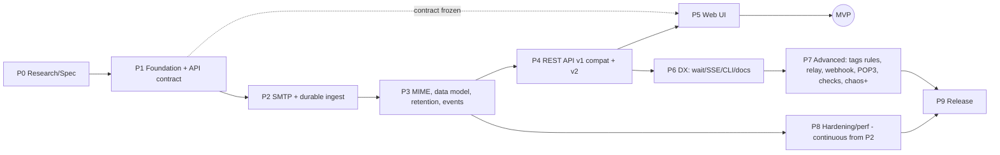

# نقشه راه، Taskها، ریسک‌ها، MVP، ADRها و نقطه توقف

## 18. Phased Roadmap

**تغییرات نسبت به فازبندی پیشنهادی درخواست (و دلیل):**
1. **Event log به Phase 3 منتقل شد** (نه Phase 6): DX-01 (`wait`) جزء MVP است و API و UI هر دو به قرارداد event وابسته‌اند.
2. **قرارداد API (OpenAPI v1 + v2) در Phase 1 نوشته می‌شود** تا UI در Phase 5 بتواند موازی با تکمیل Phase 4 شروع شود — فقط پس از freeze قرارداد.
3. **ذخیره پایدار حداقلی در Phase 2** (ingest بدون parse کامل)، چون پاسخ `250` به commit وابسته است.
4. Phase 7 به افزونه‌های مستقل شکسته شد؛ هر کدام فقط پس از تست‌های امنیتی خودش.

| فاز | هدف | خروجی | داخل | خارج | پیش‌نیاز | ADR | تست‌ها | معیار پذیرش | ریسک | پیچیدگی | Done |
|---|---|---|---|---|---|---|---|---|---|---|---|
| **P0** | تصمیم‌های تأییدشده | این مجموعه سند | ADRها | کد محصول | — | همه | — | تأیید مالک روی D1–D7 | — | M | ADRها Accepted |
| **P1** | اسکلت قابل‌ساخت | workspace، CI سه‌سکویی، CLI `serve/readyz/version`، config (CLI+env+TOML+aliasهای `MP_*`)، tracing، مدل خطا، `/livez` `/readyz`، `api/openapi-v1.json` و `v2.yaml` | — | SMTP | P0 | 001،002،010 | unit config؛ schema lint | `cargo build` و تست روی 3 OS سبز؛ `serve` در ≤150ms ready | انتخاب MSRV | S | CI سبز؛ openapi freeze v0 |
| **P2** | دریافت پایدار | SMTP state machine، TLS/STARTTLS، AUTH PLAIN/LOGIN (accept-any)، سقف‌ها، streaming به blob، تراکنش ingest، envelope، header scan سبک، migrations | parse کامل، UI | P1 | 003،004،005 | transcript، fuzz smtp (شبانه)، crash ingest، client compat (lettre/smtplib/swaks) | 100٪ transcriptها؛ kill -9 در 1000 تکرار: 0 پیام گمشده پس از `250`؛ B1 اجرا و گزارش | تفسیرهای مبهم RFC | L | — |
| **P3** | داده کامل | mime crate، parts/recipients/tags/FTS، retention (max/age/disk)، حذف، outbox/JobRunner، event log + Hub، reindex | API عمومی | P2 | 006،007،009 | corpus MIME snapshot، fuzz mime، proptest، concurrency، crash job | corpus بدون panic؛ B5/B7/B13 گزارش؛ retention هرگز > max+batch | mail-parser 1.0 تازه | L | — |
| **P4** | API | v1 compat (همه ردیف‌های جدول §8 به‌جز P2ها)، v2 (messages، envelope، mime، wait، events SSE، problem JSON)، auth Basic، CORS/Host، دانلود امن | relay، checks | P3 | 010،011 | snapshotهای API و تست‌های یکپارچه؛ امنیت T2–T8 | ≥ 95٪ تست‌های compat سبز؛ اختلاف‌ها مستند در ماتریس | تفاوت‌های ریز JSON (canonical header، null در برابر []) | M | — |
| **P5** | UI | inbox، مشاهده (HTML sandbox، text، headers، raw، MIME tree، پیوست/thumbnail)، جست‌وجو، حذف، tag دستی، live، responsive، keyboard، a11y | HTML/link check UI | P4 (+ قرارداد P1) | 013 | Playwright e2e؛ corpus XSS؛ axe-core | e2e سبز؛ axe بدون violation سطح serious؛ XSS 0 | انتخاب فریم‌ورک | L | **MVP** |
| **P6** | DX | `wait` CLI، SSE resume، doctor، transcript، chaos گسترده، export/import، نمونه‌های framework | — | P4 | — | integration | نمونه‌ها در CI اجرا شوند | — | M | — |
| **P7** | پیشرفته | tag rules/plus/X-Tags، relay/release/forward (async)، webhook، POP3، link check، HTML check، SpamAssassin، Prometheus، notifications | screenshot سرور | P6 + تست‌های امنیتی هر قابلیت | 008،014 | SSRF جدول، open relay، POP3 RFC 1939 | هر قابلیت پشت feature/flag؛ تست امنیتی پیش از ادغام | SSRF، relay abuse | L | — |
| **P8** | سخت‌سازی | کل §13، fuzz طولانی، profiling، load | — | از P2 به‌صورت پیوسته | — | همه | هدف‌های §13 یا ثبت انحراف با دلیل | — | M | — |
| **P9** | انتشار | باینری‌ها (linux x86_64/aarch64 musl، windows x86_64/aarch64، macOS x86_64/aarch64)، Docker multi-arch، Homebrew/Scoop، مستندات، SBOM، امضا (cosign/minisign) | — | P5، P8 | 012 | smoke روی هر artifact؛ regression compat | release candidate بدون باگ P0/P1 باز | — | M | v1.0 |

## 19. Task Breakdown

### Phase 0 ✅
مشخصات (docs/spec)، ADRهای 001–016، فهرست flagها و متغیرهای سازگاری، تصمیم‌های مالک (D1–D7، Q1–Q8) و نام Spoolbox.

### Phase 2 و Phase 3 — وضعیت (2026-10-25): ✅ انجام شد

تأیید مالک: «هر دو فاز» (P2 و P3). روی Windows 11 / Rust 1.99.1: `cargo fmt --check`، `cargo clippy -D warnings`، **۱۴۱ تست** سبز، `cargo deny check` سبز.

| معیار پذیرش | نتیجه |
|---|---|
| 100٪ transcriptها | ✅ ۴ transcript روی سرور Spoolbox پاس؛ + ۱۲ تست یکپارچه سرور (PIPELINING، 552 بدون desync، خط بلند، smuggling `\n.\r\n`، 421 سقف اتصال و timeout، 452 قبل از 354، AUTH LOGIN، STARTTLS با تزریق دستور پیش از handshake، implicit TLS) |
| kill -9 بدون گم‌شدن پیام پس از `250` | ✅ **۸ kill: ۱۷۸۸ پیام تأییدشده، ۰ گمشده، ۰ تغییر بایت** (TerminateProcess روی Windows). **اجرای کامل ۱۰۰۰ kill (2026-10-31): ۲۱۲٬۰۱۸ پیام تأییدشده، ۰ گمشده** (۳۹ دقیقه، build debug) |
| client compat | ✅ Python smtplib 3.13: ۶ سناریو (EHLO extensions + ۵ پیام در یک اتصال، STARTTLS اجباری + AUTH PLAIN، + AUTH LOGIN، گیرنده SMTPUTF8 فارسی، پیوست + 552 و ادامه session، SMTP_SSL) — `tools/phase2/client_compat_smtplib.py`. lettre/swaks/Nodemailer: **اجرا نشده** (P8) |
| fuzz | اهداف `smtp_session`، `data_decoder`، `mime_index` در `fuzz/` + workflow شبانه؛ **محلی اجرا نشده** (نیاز به nightly). جایگزین موقت: proptest (۲×۵۱۲ مورد MIME، round-trip و ورودی دلخواه DATA decoder) |
| corpus MIME بدون panic | ✅ ۱۴ تست MIME شامل part ID به سبک IMAP (`1.2.2`)، RFC 2231 فارسی، windows-1256، ۶۰۰ part → ۵۰۰، عمق ۴۰ → سقف، ورودی خراب |
| retention هرگز > max + batch | ✅ prune در همان تراکنش insert (نه با تأخیر دوره‌ای) — تست `max_messages_prunes_oldest_in_the_same_transaction` |
| crash job | ✅ job claim‌شده پس از «مرگ» پروسس دوباره pending می‌شود (`claimed_jobs_survive_a_crash`) |
| B1/B5/B7/B13 | ⏳ **اجرا نشد**: Docker Desktop در حین کار متوقف شد (`dockerDesktopLinuxEngine` در دسترس نبود). `Dockerfile` آماده است؛ benchmark باید پس از روشن‌شدن Docker اجرا شود |

**یافته‌های امنیتی/وابستگی:** rustls 0.23.45 چهار advisory داشت → 0.23.46 (استثنای امنیتی ADR-015)؛ zstd 0.14.2، sha2 0.11.0 به‌خاطر قاعده ۱۴ روز پین شدند.

**تفاوت‌های عمدی ثبت‌شده در این فاز:**
- `smtp-auth-file`/`MP_SMTP_AUTH` و `smtp-auth-allow-insecure` به P4 منتقل شدند (یک ماژول htpasswd مشترک با UI)؛ تا آن زمان استفاده از آن‌ها خطای صریح می‌دهد.
- MAIL دوم بدون RSET در یک تراکنش باز → `503` (RFC 5321).
- `--smtp-strict-rfc-headers` → `550 5.6.0`.
- پیام تکراری با `--ignore-duplicate-ids` → `250 2.0.0 Ok: queued` بدون ID.
- XCLIENT پیاده نشد.

**جدید در این فازها:** `--smtp-hide-extensions` (NEW-08)، `--smtp-tls-cert auto` (NEW-20)، `send-sample` با ۵ نمونه (NEW-22)، `--smtp-accept/reject/discard-domains` (NEW-28)، `--smtp-max-connections`، `reindex`، Docker image غیر root (NEW-22، ساخته نشده — Docker خاموش).

### Phase 4 — وضعیت (2026-10-31): ✅ انجام شد

تأیید مالک: «ادامه» پس از پایان P3. روی Windows 11 / Rust 1.99.1: `cargo fmt --check`، `cargo clippy -D warnings`، **۱۸۹ تست** سبز، `cargo deny check` سبز.

| معیار پذیرش | نتیجه |
|---|---|
| قرارداد API ثابت و آزموده | ✅ ۶۱ snapshot پاسخ v1 (`fixtures/api-v1/`، `tools/snapshot/api_v1.py`) که روی سرور تازه بازتولید می‌شوند + ۲۴ تست یکپارچه HTTP؛ job `API v1 snapshots` در CI؛ `api/openapi-v1.json` با `tools/api/openapi_v1.py` ساخته و در CI بررسی می‌شود |
| v1 compat | ✅ messages/search (با `start`/`limit`/`before`/`tz`)، read status، delete (IDs، search، همه)، tags (set/rename/delete)، message/headers/raw/part/thumb/release، view html/txt (+`embed=1`، `latest`، `?query=`)، send، info، webui، chaos، swagger، OPTIONS، WebSocket `/api/events` (`new`/`update`/`delete`/`truncate`/`prune`/`stats`) |
| v2 preview | ✅ `wait` (long-poll، 408)، `events` (SSE با `since`/`Last-Event-ID` و `resync`)، `envelope`، `mime`، `links`، `codes` (+`pattern`)، خطاها problem+json |
| auth Basic | ✅ crate `auth` (htpasswd: bcrypt، `$5$`/`$6$`، `$apr1$`/`$1$`، `{SHA}`، `{SSHA}`، plain؛ بردارهای OpenSSL)؛ UI/API، Send API (credentials جدا یا accept-any)، SMTP AUTH با credentials (`530` تا AUTH، `535` برای رمز غلط)؛ قواعد اعتبارسنجی (TLS لازم مگر `--smtp-auth-allow-insecure` و غیره) |
| CORS/Host | ✅ same-origin همیشه مجاز، `--api-cors` با host:port، `*`)؛ Host allowlist از P1 |
| دانلود امن | ✅ HTML/XML/SVG همیشه `application/octet-stream` + attachment؛ `filename*` (RFC 8187)؛ `/view/*.html` با CSP `sandbox` و nonce؛ thumbnail با سقف ابعاد/حافظه در برابر decompression bomb |
| امنیت T2–T8 | ✅ تست‌ها: 401 بدون/با رمز غلط، origin بیگانه 403، port متفاوت 403، عدم echo رمز در خطاها و `Debug`، رد تصویر 100000×100000 |

**ساخته‌شده در این فاز:** crate `auth`؛ `http` (v1، v2، events، access)؛ chaos در `core` (قلاب‌های MAIL/RCPT/AUTH)؛ `StoreIngest::store_raw` و شمارنده‌های `RuntimeStats`؛ `Store::filter_ids`؛ `mime::view::bodies`. P4-T08 (`header:Name=value`) از P3 موجود بود؛ P4-T09 (آدرس رشته‌ای در Send API) در v1 هم پذیرفته می‌شود؛ P4-T10 (links/codes/beacons) ✅.

**یافته‌ها و اصلاحات:**
- باگ P3: پس از اولویت HTML در snippet، متن part ساده از متن جست‌وجو حذف شده بود (`abc123` فقط در text part پیدا نمی‌شد) — اکنون هر دو body ایندکس می‌شوند.
- mail-parser برای پیام بدون HTML، HTML می‌سازد؛ `/view/{id}.html` اکنون فقط part واقعی HTML را می‌پذیرد (در غیر این صورت 404).
- شکل پاسخ حفظ شد: `ReplyTo` خالی در `/messages` برابر `[]` و در `/search` برابر `null`.
- **وابستگی‌ها:** دو advisory جدید (RUSTSEC-2026-0385 در `ctutils` از sha-crypt، RUSTSEC-2026-0391 در zstd 0.14.2) → `ctutils` 0.4.4 و zstd 0.14.3 (استثنای امنیتی ADR-015). `crc32fast` 1.5.2 و `inout` 0.2.4 به‌خاطر قاعده ۱۴ روز پین شدند؛ mail-builder 1.0.0 (2.0.0 دو روزه بود).

**باقی‌مانده / عمداً بعدی:** UI TLS (`--ui-tls-cert/key`) و `readyz --https` هنوز با خطای صریح رد می‌شوند (نیاز به accept loop TLS برای axum؛ پیشنهاد: ابتدای P5)؛ `--use-message-dates` (هشدار)؛ html-check/link-check → `501` (P2 checks)؛ release → P7؛ تست سازگاری کلاینت WebSocket UI در P5. benchmarkهای Docker هنوز منتظر روشن‌شدن Docker هستند.

### Phase 5 — وضعیت (2026-10-31): ✅ انجام شد — **MVP**

تأیید مالک: «برو برای فاز ۵».

| بخش | وضعیت |
|---|---|
| UI TLS (`--ui-tls-cert/key`، `auto`) + `readyz --https` | ✅ handshake در task جدا با timeout ۱۰ ثانیه (کلاینت ساکت بقیه را مسدود نمی‌کند)؛ تست HTTPS و رد HTTP ساده |
| embed و سرو UI | ✅ `build.rs` محتوای `web/dist` را embed می‌کند؛ `<base href>` برای webroot؛ CSP سخت UI؛ cache ابدی برای `assets/`؛ صفحه راهنما در صورت نبود build؛ احراز هویت روی صفحه‌ها هم اعمال می‌شود |
| flagها | ✅ `--hide-delete-all-button`، `--block-remote-css-and-fonts`؛ `remote=0` در `/view/{id}.html` تصاویر خارجی را مسدود می‌کند (P5-T08) |
| UI (Svelte 5 + TS) | ✅ کد: inbox زنده (WebSocket با reconnect)، جست‌وجو، صفحه‌بندی، پیام با iframe `sandbox` بدون `allow-same-origin`، تب‌های text/headers/raw/ساختار MIME (P5-T07)/پیوست با thumbnail/لینک‌ها و کدها/envelope، tag دستی، حذف، خوانده/نخوانده، صفحه‌کلید، فارسی/RTL، حالت تاریک |
| تست‌ها | ✅ نوشته‌شده: Playwright (inbox زنده، جست‌وجو و tag، صفحه‌کلید، مسدودسازی تصاویر بدون درخواست خارجی، RTL، axe بدون violation جدی) + corpus XSS (۱۲ مورد در `fixtures/xss/`)؛ job `web` در CI |
| معیارهای پذیرش | ✅ `svelte-check` بدون خطا و هشدار؛ build: JS ۷۲ KB (gzip ۲۷ KB)؛ **Playwright ۱۸/۱۸ سبز** (۶ سناریوی UI + ۱۲ مورد XSS ← XSS صفر)؛ axe بدون violation سطح serious/critical روی inbox و نمای پیام؛ بازبینی چشمی screenshot در LTR/RTL و موبایل (اصلاح جای‌گیری متن دوجهته با `<bdi>`) |
| وابستگی‌های npm | ✅ `package-lock.json` با ۷۷ بسته؛ همه ≥ ۱۴ روز (پنج وابسته غیرمستقیم جوان با `overrides` پین شدند: rolldown 1.2.14، postcss 8.5.30، magic-string 1.4.3، @types/estree 1.0.9)؛ نصب با `--ignore-scripts` |
| یافته جانبی | تست `implicit_tls` گاهی شکست می‌خورد: دو تست موازی به‌خاطر دقت کم ساعت Windows پوشه موقت یکسان می‌گرفتند و گواهی هم را می‌خواندند — با شمارنده یکتا رفع شد |

نسخه‌های npm با قاعده ۱۴ روز: svelte 5.57.2، vite 8.3.4، @sveltejs/vite-plugin-svelte 7.3.1، typescript 6.0.3 (svelte-check هنوز TS 7 را نمی‌پذیرد)، svelte-check 4.7.7، @playwright/test 1.64.1، @axe-core/playwright 4.14.0.

### Phase 7 — وضعیت (2026-11-04): 🚧 در حال انجام

| قابلیت | وضعیت |
|---|---|
| tag rules | ✅ `--tag`، `--tags-config`، `[[tags.rules]]` |
| webhook | ✅ `--webhook-url` با outbox، retry و امضای HMAC؛ فقط https یا همین ماشین مگر با `--allow-internal-http-requests`؛ timeout پنج ثانیه؛ هدر امضا `X-Spoolbox-Signature` است |
| relay/release/forward | ✅ سرور، API و دکمهٔ release در UI |
| POP3 | ✅ RFC 1939 با `TOP`، `UIDL`، `CAPA` و `STLS` |
| link check، HTML check، Prometheus، notifications | ⏳ |

**relay و forward:**

- **پیش‌فرض خاموش است.** بدون host، هیچ پیامی از سرور خارج نمی‌شود و `release` پاسخ 400 می‌دهد.
- **تنظیمات:** فایل YAML با `--smtp-relay-config` و `--smtp-forward-config` (یا `relay.config` و `forward.config` در TOML)، و متغیرهای `SPOOLBOX_SMTP_RELAY_*` و `SPOOLBOX_SMTP_FORWARD_*` یا معادل `MP_*` آن‌ها. متغیرها بر فایل مقدم‌اند و `SPOOLBOX_*` بر `MP_*`.
- **کلیدهای فایل:** `host`، `port` (پیش‌فرض 25)، `starttls`، `tls`، `allow-insecure`، `auth` (`none`، `plain`، `login`)، `username`، `password`، `return-path`، `override-from`، `rate-limit` (پیام در دقیقه، پیش‌فرض 60، صفر یعنی بدون سقف)، `preserve-message-ids`؛ فقط برای relay: `allowed-recipients`، `blocked-recipients`؛ فقط برای forward: `to`.
- **ارسال خودکار:** `--smtp-relay-all` به `allowed-recipients` نیاز دارد و بدون آن سرور بالا نمی‌آید (T16). `--smtp-relay-matching` فقط گیرنده‌های منطبق را می‌فرستد.
- **ناهمگام:** ارسال هرگز داخل نشست SMTP یا درخواست API انجام نمی‌شود. خطای موقت با backoff تکرار می‌شود (حداکثر ۸ بار) و خطای دائمی (5xx) بلافاصله به‌صورت job ناموفق نگه داشته می‌شود. به همین دلیل `MP_SMTP_RELAY_FWD_SMTP_ERRORS` اثری ندارد.
- **ساخت job اتمی است:** job‌های webhook، relay و forward در همان تراکنشِ پایان index ساخته می‌شوند، پس crash نه آن‌ها را از دست می‌دهد و نه دوبار می‌سازد. index دوباره (`reindex`) هیچ ارسالی ایجاد نمی‌کند.
- **تحویل دست‌کم یک‌بار:** اگر پردازه وسط ارسال از بین برود، همان پیام ممکن است دوباره ارسال شود. `Message-ID` جدید در retryها ثابت می‌ماند تا گیرنده بتواند تکرار را تشخیص دهد.

**کنترل‌های امنیتی (T16)، هرکدام با تست:**

- سیاست گیرنده بدون حساسیت به حروف بزرگ و کوچک اعمال می‌شود و درست پیش از ارسال هم دوباره چک می‌شود.
- فقط آدرس ساده (`local@domain`) پذیرفته می‌شود، پس تزریق فرمان SMTP با CRLF ممکن نیست.
- `release` فقط `application/json` می‌پذیرد تا فرم cross-site نتواند ایمیل را به آدرس مهاجم بفرستد.
- پیام‌های `import` هرگز خودکار ارسال نمی‌شوند.
- `Bcc` و `Return-Path` از پیام ارسالی حذف می‌شوند.
- ارسال password بدون TLS به مقصد غیر loopback رد می‌شود، مگر با `allow-insecure`.
- مقصدی که همان پورت SMTP خود سرور روی loopback باشد رد می‌شود تا حلقه ایجاد نشود.
- password در `Debug`، `/api/v1/webui` و پیام‌های خطای YAML دیده نمی‌شود.
- هر ارسال با گیرنده‌هایش log می‌شود.

**POP3:**

- **پیش‌فرض خاموش است.** با `--pop3 <آدرس>` فعال می‌شود و بدون کاربر (`--pop3-auth-file` یا `MP_POP3_AUTH`) سرور بالا نمی‌آید، چون POP3 می‌تواند همهٔ پیام‌ها را بخواند و حذف کند. گزینه‌های POP3 بدون `--pop3` هم خطا می‌دهند.
- **یک صندوق مشترک:** همهٔ کاربران همان پیام‌ها را می‌بینند. session حداکثر ۱۰٬۰۰۰ پیام جدیدتر را نشان می‌دهد، قدیمی‌ترین با شمارهٔ ۱.
- **رمزنگاری:** با `--pop3-tls-cert` (یا `auto`) و `--pop3-tls-key` فرمان `STLS` فعال می‌شود و کلاینت‌های غیر loopback بدون آن نمی‌توانند `USER` و `PASS` بفرستند. فقط STLS پشتیبانی می‌شود، نه TLS از بایت اول (ADR-016). گوش دادن روی شبکه بدون TLS رد می‌شود، مگر با `--allow-unauthenticated-network`.
- **حذف فقط با `QUIT`:** قطع اتصال هیچ پیامی را حذف نمی‌کند (RFC 1939). `RETR` پیام را خوانده‌شده می‌کند، ولی `TOP` نه.
- **`LIST` و `STAT`:** اندازهٔ ذخیره‌شده را می‌گویند. پیامی که با LF ساده import شده باشد موقع ارسال به CRLF تبدیل می‌شود و کمی بزرگ‌تر از عدد اعلام‌شده است.
- **کنترل‌های امنیتی (T19):** تأخیر تلاش ناموفق per-IP که با هر شکست دو برابر می‌شود (از ۲۰۰ms تا ۵s) و با اتصال دوباره صفر نمی‌شود؛ قطع اتصال پس از سه تلاش؛ پاسخ یکسان برای کاربر ناشناس و password غلط؛ دور ریختن فرمان‌های ارسال‌شده پیش از handshake (STLS injection)؛ سقف طول خط و تعداد اتصال. `APOP` و `AUTH` عمداً پیاده نشده‌اند.

**تغییر سازگاری:** CRAM-MD5 پشتیبانی نمی‌شود؛ `auth: cram-md5` و `MP_SMTP_RELAY_SECRET` سرور را با خطای صریح متوقف می‌کنند.

### Phase 6 — وضعیت (2026-10-31): ✅ انجام شد

تأیید مالک: «برو برای فاز ۶». **۲۱۳ تست Rust** و **۱۹ تست Playwright** سبز؛ clippy و cargo-deny سبز.

| بخش | نتیجه |
|---|---|
| `wait` CLI (DX-01) | ✅ `spoolbox wait QUERY --timeout --since --json`؛ کد خروج ۱ در timeout؛ انتظار بیش از ۵ دقیقه به چند درخواست تقسیم می‌شود بدون ازدست‌رفتن پیام؛ endpoint جدید `GET /api/v2/events/cursor` برای الگوی بدون race (cursor → ارسال → wait) |
| SSE resume (DX-04) | ✅ از P4 (`since` و `Last-Event-ID` با `resync`) |
| doctor (DX-06) | ✅ پیکربندی، پورت آزاد/در اختیار Spoolbox/در اختیار برنامه دیگر، گواهی TLS، دسترسی نوشتن و فضای دیسک، در معرض شبکه بودن؛ کد خروج ۱ با هر FAIL |
| transcript (DX-07) | ✅ `--smtp-transcripts`: ۲۰۰ نشست اخیر در حافظه؛ AUTH همیشه redacted، بدنه پیام هرگز ثبت نمی‌شود؛ `/api/v2/transcripts`، `/api/v2/messages/{id}/transcript`، تب SMTP در UI |
| chaos قانون‌محور (DX-08، P6-T05) | ✅ قوانین مرتب با `stage` (connect، sender، recipient، data، message، auth)، `match` (regex)، `code`/`message`، `delay_ms`، `disconnect`، `times`؛ از `[[chaos.rules]]` در TOML و `GET/PUT/DELETE /api/v2/chaos/rules` (شمارنده `fired`)؛ تست deterministic با `times` |
| export/import (DX-11) | ✅ `spoolbox export` (‎.eml یا mbox با فرمت mboxrd) و `import` (فایل، پوشه، mbox)؛ endpoint جدید `POST /api/v2/messages` (ذخیره خام بایت‌به‌بایت، منبع `import`)؛ ID پاسخ سرور نمی‌تواند مسیر فایل را تعیین کند |
| نمونه‌های framework (DX-13) | ✅ `examples/`: Python، Node.js، Go، shell (curl + `spoolbox wait`)، Docker Compose، تنظیمات SMTP برای Laravel/Symfony/Django/Rails/Spring/.NET/Nodemailer/Go؛ job `examples` در CI (Go فقط در CI اجرا شد — محلی نصب نیست) |
| MCP (P6-T10) | ✅ `POST /mcp` (JSON-RPC 2.0، Streamable HTTP، بررسی Origin) + `spoolbox mcp` (پل stdio)؛ ابزارها: list_messages، wait_for_message، event_cursor، get_message (بدون side effect)، get_codes، get_links، get_raw؛ `delete_messages` فقط با `--mcp-allow-delete` و هرگز با query خالی |
| testkit in-process (P6-T11) | ✅ `spoolbox-testkit` با feature `server`: `TestServer` (SMTP، ذخیره، index، HTTP روی پورت‌های تصادفی)، `wait_for`، `raw`، `chaos`، تابع `send`؛ نمونه در `crates/spoolbox/tests/testkit.rs` در CI |

**یافته در حین کار:** اسکریپت‌های ویرایش Python در این محیط دنباله‌های escape را به خط جدید واقعی تبدیل می‌کردند و دو تست را خراب کردند؛ پیدا و اصلاح شد (کد محصول تحت تأثیر نبود).

### Taskهای افزوده
| Task | قابلیت | ورودی | خروجی | پذیرش |
|---|---|---|---|---|
| P2-T10 | NEW-08 `--hide-extensions` و پروفایل سرور | SMTP-01 | flag + پروفایل‌ها | transcript برای هر extension مخفی: در EHLO نیست و فرمان مربوط `502` می‌گیرد |
| P2-T11 | NEW-20 `--tls auto` | rcgen | گواهی موقت + fingerprint در log | اتصال `openssl s_client -starttls smtp` موفق |
| P2-T12 | NEW-22 `send-sample` + corpus نمونه | fixtures | زیرفرمان | ۱۰ نمونه (شامل فارسی/RTL) بدون خطا parse و نمایش |
| P2-T13 | NEW-28 accept/reject/discard دامنه | SMTP-03 | flagها | تست هر سه حالت |
| P4-T08 | NEW-09 توکن `header:Name=value` | search crate | parser + index هدرهای سفارشی (سقف ۸ KiB هدر برای هر پیام) | fixture با هدر سفارشی پیدا شود |
| P4-T09 | NEW-17 آدرس رشته‌ای در Send API v2 | API-03 | — | contract |
| P4-T10 | NEW-02 استخراج links/codes/beacons | mime crate | `/api/v2/messages/{id}/links`، `/codes` | fixtureهای OTP (۴–۸ رقم، الفبایی، داخل لینک) |
| P5-T07 | NEW-13 render هر MIME part | MIME-11 | UI درخت + انتخاب part/زبان | fixture دوزبانه ۴-partی همه partها را نشان دهد |
| P5-T08 | NEW-18 کنترل محتوای remote | Q4 | toggle per-message، تشخیص pixel | تست Playwright: درخواست شبکه خارجی تا کلیک نشود صفر |
| P6-T05 | NEW-09b Chaos قانون‌محور | SMTP-15 | قوانین TOML + API | تست deterministic `times: N` |
| P6-T10 | NEW-01 سرور MCP | API v2 | `spoolbox mcp` (stdio) + `/mcp` | تست با MCP inspector؛ حذف بدون flag ممنوع |
| P6-T11 | NEW-11 crate `testkit` | app | راه‌اندازی in-process | نمونه تست Rust در CI |
| P7-T01..T03 | NEW-03/NEW-04 namespace + قوانین مسیریابی + naming | schema P3 | مسیریابی (AUTH user، گیرنده، هدر، listener)، API/UI محدود به namespace | جداسازی: کاربر namespace A هیچ پیام B را از هیچ endpointی نبیند (تست امنیتی) |
| P7-T04 | NEW-16 چند listener + tag/namespace per listener | SMTP | config آرایه listenerها | — |
| P7-T05 | NEW-19 XOAUTH2/OAUTHBEARER در accept-any | SMTP-11 | — | تست با token ساختگی |
| P7-T06 | NEW-26 forward-auth پشت proxy | API-05 | `--trusted-proxy-cidrs`، هدر کاربر | هدر از IP غیرمجاز نادیده گرفته شود |
| P7-T10 | NEW-06 IMAP فقط‌خواندنی | Query، namespace | سرور IMAP4rev2 زیرمجموعه | تست با Thunderbird، Python imaplib، Jakarta Mail؛ IDLE |
| P7-T20 | NEW-07 شبیه‌سازی SES/SendGrid/Postmark | Send | feature `provider-emulation` | SDK رسمی هر ارائه‌دهنده با endpoint محلی پیام بسازد |
| P9-T02 | NEW-22 Docker non-root | — | `USER 65532` | اجرای image با `--read-only` و بدون root |
| P9-T03 | NEW-23 checksums + امضا + SBOM | — | `SHA256SUMS`، امضا | تأیید در CI |
| P9-T05 | NEW-21 Helm chart | — | `deploy/helm/` | `helm lint` + kind smoke |
| P9-T06 | NEW-24 deb/rpm + systemd + Windows service | — | بسته‌ها | نصب و start روی Debian، Fedora، Windows |
| P9-T07 | NEW-05/NEW-29 SDK TS/Python، helper Playwright/Cypress، ماژول Testcontainers/Aspire | OpenAPI v2 | بسته‌ها | نمونه‌ها در CI |

### Phase 1 (اولین فاز اجرایی — پس از تأیید)

**وضعیت (2026-10-24): ✅ همه taskهای P1-T01..T08 انجام شد** — روی Windows 11 (toolchain 1.99.1 MSVC) سبز: `cargo fmt --check`، `cargo clippy -D warnings`، `cargo test` (۵۶ تست)، `cargo deny check`، lint OpenAPI (Redocly 2.62.1). CI سه‌سکویی نوشته شده ولی **هنوز روی GitHub اجرا نشده** (مخزن remote ندارد).

| معیار پذیرش P1 | نتیجه |
|---|---|
| `serve` تا ready ≤ 150 ms | ✅ median **29 ms** (Windows native، از spawn پروسس تا اولین 200 روی `/readyz`، ۲۰ اجرا؛ `tools/phase1/startup_idle.py`) |
| هر flag/env سازگاری: پذیرش یا خطای صریح | ✅ registry با ۷۱ flag و ۱۰۵ متغیر `MP_*` |
| idle | working set **6.2 MiB**، private 2.3 MiB (Windows، ۱۰ ثانیه پس از ready) |
| حجم باینری release | **1.6 MiB** (`spoolbox.exe`، فقط HTTP/config؛ با SMTP/SQLite/UI بزرگ‌تر می‌شود) |
| harness transcript | ✅ ۴ transcript روی سرور واقعی پاس شدند؛ با پورت بسته شکست خوردند (اثبات اجرای واقعی) |

**انحراف‌ها از طرح (عمدی):** crate جدا `config` (مرز واقعی: هم bin و هم readyz و تست‌ها مصرف می‌کنند)؛ `testkit` زودتر از P6 ساخته شد (برای harness)؛ قراردادهای OpenAPI به‌صورت **JSON** (تولید deterministic و diff در CI)؛ cargo-audit حذف شد چون cargo-deny همان advisoryها را بررسی می‌کند؛ `readyz --https` تا P4 خطای صریح می‌دهد.

**یافته‌های جانبی P1:**
- **امنیتی:** cargo-deny روی tokio 1.53.2 advisory `RUSTSEC-2026-0386` گزارش کرد → ارتقا به 1.53.3 + استثنای امنیتی در ADR-015.
- env منسوخ `MP_SMTP_SSL_KEY` با نام اشتباه رایج `MP_SMTP_SMTP_KEY` هم پذیرفته می‌شود.
- **Host allowlist پیش‌فرض** (تکمیل ADR-008): IP literal، `localhost`/`*.localhost` و نام‌های تک‌بخشی (نام سرویس Docker مثل `spoolbox`) مجازند؛ نام‌های چندبخشی (قابل‌استفاده در DNS rebinding) فقط با `--allowed-hosts`. `/livez` و `/readyz` از این بررسی معاف‌اند (probeهای Kubernetes).

| Task | ورودی | خروجی | پذیرش |
|---|---|---|---|
| P1-T01 Workspace و lint | ساختار §17 | `Cargo.toml`، `rust-toolchain.toml`، clippy/rustfmt، cargo-deny | `cargo deny check` سبز |
| P1-T02 CI | — | GitHub Actions: build/test سه OS، deny، audit | سبز روی PR خالی |
| P1-T03 مدل خطا و `core` | §9 | انواع دامنه | unit |
| P1-T04 Config | §16 CLI/env | parser با alias `MP_*`، TOML، خطای «did you mean» | تست هر flag سازگاری: پذیرش یا خطای صریح |
| P1-T05 Tracing و log | — | فرمت text/json، redaction | تست redaction |
| P1-T06 HTTP اسکلت + `/livez` `/readyz` + `readyz --wait` | — | — | B11 اولیه |
| P1-T07 OpenAPI v1 و v2 پیش‌نویس | رفتار API | `api/*.yaml` | lint (spectral/redocly) سبز |
| P1-T08 harness transcript SMTP و fixture layout | — | `fixtures/smtp/` قالب | — |

## 20. Risks and Open Questions

| # | ریسک | احتمال | اثر | کاهش |
|---|---|---|---|---|
| R1 | mail-parser 1.0 تازه/ناپایدار؛ نبود offset part | متوسط | بالا | پین 0.x؛ wrapper `mime` با trait؛ ارزیابی P0-T05 |
| R2 | ناسازگاری ریز JSON v1 (null/[]، canonical header، فرمت تاریخ نانوثانیه RFC3339) | بالا | متوسط | fixtures ضبط‌شده P0-T07 |
| R3 | رشد WAL/فایل DB با پیام‌های بزرگ | متوسط | متوسط | B-STOR؛ incremental vacuum |
| R4 | cross-compile با C deps (sqlite bundled، zstd، ring) | متوسط | متوسط | cargo-zigbuild یا cross؛ تست در P1 |
| R5 | FTS5 trigram حجم index ~3× متن | متوسط | کم | اندازه‌گیری B7؛ گزینه `--search-index=off` |
| R6 | scope creep از قابلیت‌های P2 | بالا | بالا | MVP سخت (§21) |
| R7 | تفسیر «clean-room» مجوز | کم | بالا | §15 سیاست |

**تصمیم‌گرفته‌شده توسط مالک (2026-10-24):**
- Q1 ✅ نام: **Spoolbox** — باینری `spoolbox`، prefix env `SPOOLBOX_`، هدرهای بومی `X-Spoolbox-*`. (بررسی علامت تجاری/دامنه/رجیستری‌ها همچنان در P0-T10.)
- Q9 ✅ MCP (NEW-01، P6) و IMAP (NEW-06، P7) هر دو **در v1.0**.
- Q10 ✅ Namespace (NEW-03) **در v1.0**: schema از P3، قابلیت در P7.

- Q2 ✅ frontend: **Svelte 5 + TypeScript + Vite** (ADR-013).
- Q3 ✅ API v2 در MVP **حداقلی** با برچسب preview (wait، envelope، mime، links، codes، events)؛ **در نسخه‌های بعدی کامل و جامع می‌شود** (ADR-010).
- Q4 ✅ تصاویر remote: `local` بارگذاری + دکمه مسدودسازی + گزارش pixel؛ `shared` مسدود (ADR-016).
- Q5 ✅ Windows در MVP، CI سه‌سکویی از P1.
- Q6 ✅ POP3 در v1.0 (P7)؛ SpamAssassin بعد از v1.0، فقط spamd محلی.
- Q7 ✅ 500 پیام، 50 MiB، max-age خاموش، محافظ دیسک < 1 GiB → `452`.
- Q8 ✅ CRAM-MD5 حذف.

**سؤال باز:** هیچ‌کدام برای ورود به Phase 1.

## 21. Definition of MVP

MVP = ابزار قابل‌استفاده برای **توسعه محلی و CI معمولی**:
- SMTP: SMTP-01..09، 11 (accept-any)، 12، 14، 17، 19، 20 + PIPELINING.
- ذخیره پایدار و ephemeral، retention max/age، حذف تکی/جست‌وجو/همه، read/unread.
- MIME کامل برای نمایش (text، HTML، پیوست، inline، هدرها، raw، درخت MIME، خطای parse).
- جست‌وجو: کل گرامر §5.4.
- API v1: ردیف‌های 1–15، 20–24 جدول §8 + `wait` + `envelope` + استخراج links/codes (NEW-02) (v2).
- `--hide-extensions` (NEW-08) و `send-sample` (NEW-22) — کم‌هزینه و مفید برای دیباگ.
- UI: P5.
- Event log + WebSocket سازگار v1.
- امنیت: T1–T5، T7، T8، T11، T12، T14، T15، T18، T20، T21.
- Docker image و باینری linux/macOS/windows x86_64 و aarch64 (بسته به Q5).

**خارج از MVP:** relay/forward، webhook، POP3، link/HTML/spam check، screenshot، Prometheus، namespace، Chaos گسترده (Chaos سازگار v1 داخل MVP؟ → پیشنهاد: بله، کم‌هزینه).

## 22. Acceptance Criteria (MVP)

1. `cargo xtask test-all` روی Linux/Windows/macOS: 0 شکست.
2. همه transcriptهای SMTP و ماتریس کلاینت (lettre، smtplib، Nodemailer، PHPMailer، swaks): 0 شکست.
3. Contract v1: ≥ 95٪ endpointها/fixtureها Full؛ باقی در ماتریس به‌عنوان Partial/Diff با دلیل.
4. Crash test: 0 پیام گمشده پس از `250` در 1000 kill.
5. Fuzz: هر هدف ≥ 1 ساعت تجمعی بدون crash.
6. Corpus XSS و SSRF (برای قابلیت‌های موجود): 0 عبور.
7. Benchmarkهای B1، B4، B6، B7، B8، B11، B12 اجرا و منتشر شده؛ هر هدف §13 که برآورده نشده با تحلیل مستند.
8. مستندات: نصب، پیکربندی، مهاجرت، مرجع API.

## 23. Architecture Decision Records (پیشنهادی)

| ADR | عنوان | تصمیم پیشنهادی | وضعیت |
|---|---|---|---|
| 001 | سبک معماری | Modular monolith، یک باینری | Proposed |
| 002 | Runtime و HTTP | tokio + axum + tower-http | Proposed |
| 003 | ذخیره پیام خام | SQLite blob پیش‌فرض؛ trait برای فایل؛ تصمیم نهایی با B-STOR | Proposed (benchmark-gated) |
| 004 | پایگاه داده | SQLite (rusqlite bundled، WAL، یک writer + pool خواننده) | Proposed |
| 005 | معنای `250` | فقط پس از commit پایدار | Proposed |
| 006 | Envelope و raw | envelope جدا؛ raw byte-exact؛ شبیه‌سازی v1 در لایه API | Proposed |
| 007 | جست‌وجو | parser مستقل → SQL + FTS5 trigram؛ keyset pagination | Proposed |
| 008 | پیش‌فرض‌های شبکه | loopback، Host allowlist، بدون egress پیش‌فرض | Proposed |
| 009 | رویدادها | event log ترتیبی پایدار + outbox | Proposed |
| 010 | نسخه‌بندی API | v1 compat + v2؛ flagهای compat | Proposed |
| 011 | قرارداد API | spec-first OpenAPI + contract tests | Proposed |
| 012 | مجوز و استقلال | MIT | Accepted |
| 013 | Frontend | منتظر Q2 | Open |
| 014 | سیاست egress (SSRF) | ماژول مستقل با تست‌های جدول T9 | Proposed |
| 015 | سیاست toolchain و وابستگی | `rust-toolchain.toml` پین روی **1.99.1** (آخرین stable، هم‌سان با محیط توسعه مالک)؛ MSRV اعلام‌شده برای `cargo install` = **1.98** (stable−1)؛ ارتقای toolchain در هر release جدید Rust طی ≤ 2 هفته؛ cargo-deny؛ بدون نسخه crate < 14 روز | Proposed |

## 15 (درخواست). مجوز، انتشار و استقلال پروژه

- مجوز Spoolbox: **MIT** (ADR-012)، صاحب حق نشر Goudarz Jafari <hi@goudarzjafari.com>. همه کد و داده‌های مخزن متعلق به همین پروژه است؛ قرارداد API v1 (`api/openapi-v1.json`) و snapshotها (`fixtures/api-v1/`) از خود Spoolbox تولید می‌شوند.
- مجوز همه وابستگی‌ها با cargo-deny بررسی می‌شود و گزارش `THIRD_PARTY_LICENSES` در هر release تولید می‌شود.
- داده caniemail (HTML check): مجوز آن پیش از استفاده بررسی شود.

## 24. منابع

- crates.io API: `https://crates.io/api/v1/crates/<name>`
- Rust stable: https://static.rust-lang.org/dist/channel-rust-stable.toml (1.99.1، 2026-10-13)
- RFCها: RFC 5321، 1870، 2034، 2920، 3030، 3207، 3463، 4616، 4954، 6152، 6531، 6532، 8314، 5322، 2045–2049، 2183، 2231، 2369، 2392، 8058، 1939، 2595
- caniemail: https://www.caniemail.com/

---

## 18. نقطه توقف و تأیید

### 1. مهم‌ترین تصمیم‌های نیازمند تأیید
✅ همه تأیید شدند (2026-10-24): D1 modular monolith · D2 SQLite blob (benchmark-gated) · D3 loopback · D4 v1 سازگار + v2 · D5 MIT · D6 Svelte · D7 حذف rqlite/tenant. جزئیات: [docs/adr/](../adr/README.md).

### 2. ابهام‌های حل‌نشدنی بدون مالک
Q1–Q8 در §20.

### 3. فاز پیشنهادی شروع
**انجام شد.**

### 4. Taskهای دقیق اولین فاز اجرایی
Phase 1: P1-T01 تا P1-T08 (§19).

### 5. معیارهای ورود به پیاده‌سازی
- ✅ ADRهای 001–016 در وضعیت Accepted.
- ✅ پاسخ همه سؤال‌ها (Q1–Q10).
- ⏳ نسخه crateهای «Not verified» (P0-T05) — **مسدودکننده نیست**؛ در P1-T01 هنگام نوشتن `Cargo.toml` با `cargo search`/crates.io تکمیل می‌شود.
- ⏳ P0-T03 (RFCها)، P0-T10 (علامت تجاری/دامنه) — مسدودکننده نیستند.
- **باقی‌مانده: اجازه صریح مالک برای شروع Phase 1 (نوشتن کد).**
